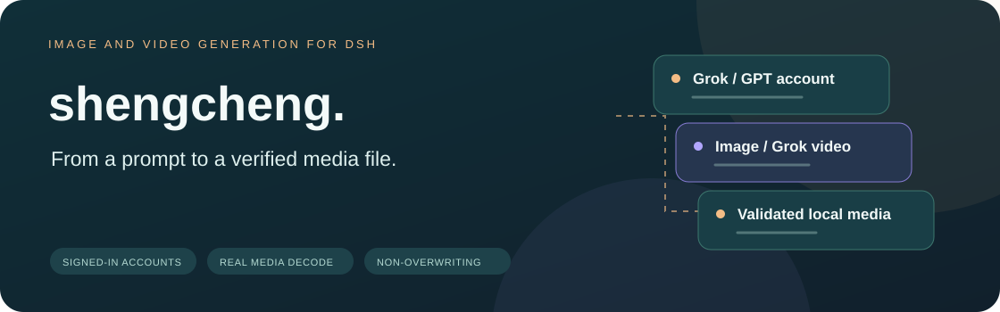
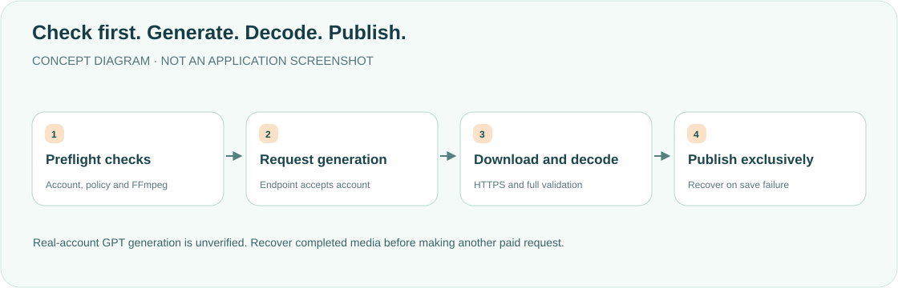

<div align="center">

<h1>shengcheng · Turn ideas into media</h1>
<p><strong>Generate images with DSH's signed-in accounts, and videos with Grok.</strong></p>
<p><a href="README.md">简体中文</a> · <strong>English</strong></p>
<p><a href="package.json">v0.1.1</a> · <a href="LICENSE">MIT</a> · DSH desktop plugin</p>
<p><a href="#features">Features</a> · <a href="#how-it-works">How it works</a> · <a href="#installation">Installation</a> · <a href="#parameters-and-boundaries">Boundaries</a> · <a href="#development">Development</a></p>
</div>

---

A personal desktop-workflow reference, not a drop-in universal configuration. **Chat login does not guarantee access to generation endpoints. Real-account GPT generation is not yet verified.** The current conversation need not use Grok/GPT. Do not use API keys or ask the model to call curl.

## Features

<table><tr>
<td width="33%"><strong>🎨 Two image providers</strong><br/><br/>Grok Imagine and GPT Image without giving keys/tokens to the model.</td>
<td width="33%"><strong>🎬 Grok video</strong><br/><br/>Text/reference-image video workflows; no GPT video generation in this plugin.</td>
<td width="33%"><strong>🧪 Real media validation</strong><br/><br/>FFmpeg/ffprobe fully decode outputs; error pages are not saved as images.</td>
</tr><tr>
<td><strong>🔐 Host-side renewal</strong><br/><br/>Shared credential locking prevents stale refresh overwrites after account changes.</td>
<td><strong>📁 Non-overwriting outputs</strong><br/><br/>Session file policy, private staging and exclusive publication preserve actual paths.</td>
<td><strong>🧾 Recoverable failures</strong><br/><br/>A completed generation with failed publication reports a recovery path rather than encouraging another paid request.</td>
</tr></table>

## How it works



The single tool is `shengcheng`: `kind=image` by default or `kind=video`. Grok uses `grok-imagine-image-2.0` / `grok-imagine-video-1.5`; GPT images use `gpt-image-2`. `provider=auto` uses the current Grok/GPT provider, otherwise available Grok, then GPT. GPT video is rejected.

Host-only credentials use `$DSH_HOME/.credentials.yaml` keys `llm-pi-ai/xai` and `llm-pi-ai/openai-codex`; never other CLI auth.json files. Output defaults to session cwd, otherwise Downloads. The actual saved path/format is returned through `shengcheng_result`; old `saved …` compatibility remains for zhanshi.

## Installation

Clone/copy this repository into `$DSH_HOME/plugins/shengcheng`. Merge into the desktop `cordis.patch.yml`, retaining other plugins:

```yaml
- insert:
    - id: shengcheng
      name: ../../plugins/shengcheng/lib/index.js
```

Install both `ffmpeg` and `ffprobe` (macOS: `brew install ffmpeg`). PATH and standard Homebrew/system locations are checked by actually starting both programs **before paid generation**. In the plugin source directory:

```bash
pnpm install --frozen-lockfile
```

Use the declared pnpm11.7.0 and pinned official `@earendil-works/pi-ai@0.87.1` renewal implementation. Unrelated provider install scripts are disabled in the workspace configuration. Fully quit DSH with ⌘Q, reopen and start a new session; page refresh does not replace loaded Host code. Log into the desired account using OAuth first.

## Parameters and boundaries

- GPT images support exact `1:1 → 1024x1024`, `3:2 → 1536x1024`, `2:3 → 1024x1536` here. Unsupported ratios or conflicting size/ratio fail before the request, without silent reshaping. This is not a claim about all upstream capabilities.
- Images reject duration/image_path; videos reject quality/size; Grok images reject size and GPT images reject resolution. Irrelevant fields are errors, not silently ignored.
- Official sandboxPolicy/fs checks output before generation and again before saving/validation. Read-only forbids saving; workspace-write follows official workspace/temp roots. Missing Host adapters fail without elevation or unrestricted filesystem fallback.
- Private0600 staging, chunked writes, fsync and non-overwriting hard-link publication use the actual format extension; collisions receive numbered names. Requires local hard-link support. Inode checks reduce ordinary replacement races, not malicious-process kernel isolation.
- Failed publication may retain a fully written recovery file and its true format. Recover that file first; it is not a successfully published output. Cancel before completion cleans staging; cancel afterward may leave recovery media.
- Downloads require public HTTPS destinations, per-redirect DNS checks and pinned addresses, without account credentials. Credential contents are redacted from business/HTTP/transport/renewal errors; cancel/timeout types remain explicit.
- Limits: JSON48MiB, images32MiB, videos256MiB, reference images15MiB. Reference inputs must be regular files and use official bounded reads, not write-fence checks or bare-fs fallbacks.
- Full decoding checks PNG CRC, up to64Mi pixels,300 image frames, and30 seconds/2,000 video frames. Validation has a60-second deadline and reaps cancelled subprocesses. Attached cover/thumbnail tracks are excluded from playable-video counting; multiple real video tracks, audio-only or truncated files fail.

<details>
<summary><strong>Credential continuity and cancellation</strong></summary>

Renewal uses the shared Host credential lock. Switching/logout while waiting cannot be overwritten by stale refresh; uncertain continuity stops explicitly. Valid rotated credentials persist even if later work fails. Cancel/timeout interrupts generation and video polling. HTTPS downloads do not carry credentials. Concurrent saves never overwrite files; media errors are not reported as success. Private validation subdirectories are restricted to approved output locations and cleaned afterward.

</details>

## Development

Official FS/OAuth integration requires a complete read-only extracted installation. Missing DSH_OFFICIAL_ROOT/packages fails, not skips or an old checkout fallback. Fixtures write random temporary files, use synthetic credentials/mock networking and never invoke paid generation or real refresh.

```bash
export DSH_OFFICIAL_ROOT=/absolute/path/to/extracted-official-runtime
for file in lib/*.js; do /usr/local/bin/node --check "$file" || exit; done
/usr/local/bin/node --test
```

<details>
<summary><strong>Historical evidence—not this update's test results</strong></summary>

2026-10-12:97/97 tests and real official0.2.1-alpha.2 isolated filesystem fixtures covered reference reads, output policy, cancellation and policy changes. pi-ai0.87.1/1.0.2 refresh/toAuth comparisons did not require a dependency upgrade. 2026-10-08:89 tests and a real downloaded video verified cover-track handling. 2026-10-07:88 tests and120 zhanshi checks covered structured paths and media behavior. Earlier2026-10-06 Grok image/video success predates those fixes; it does not verify GPT or the current loaded desktop. Detailed original records remain in the [Chinese README](README.md).

</details>

**This documentation update checks bilingual content, diagrams, links and layout only. Product suites, paid generation and a desktop restart were not performed.** A successful old version is not acceptance of the current loaded runtime.

[MIT License](LICENSE).

<div align="center"><sub>Generate deliberately. Save verifiably. · <a href="README.md">阅读中文版 →</a></sub></div>
