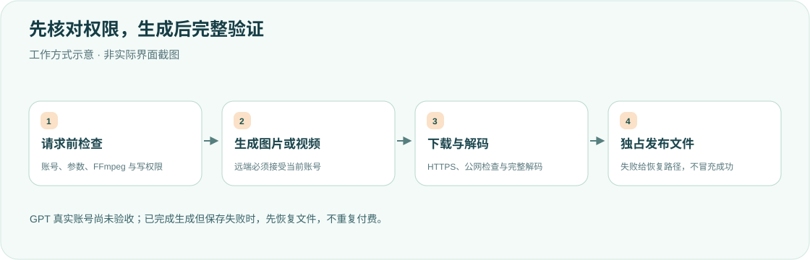

<div align="center">

<h1>shengcheng · 让想法成为媒体</h1>
<p><strong>使用 DSH 已登录账号生成图片，用 Grok 生成视频。</strong></p>
<p><strong>简体中文</strong> · <a href="README.en.md">English</a></p>
<p><a href="package.json">v0.1.2</a> · <a href="LICENSE">MIT</a> · DSH desktop plugin</p>
<p><a href="#核心能力">核心能力</a> · <a href="#工作方式">工作方式</a> · <a href="#安装">安装</a> · <a href="#参数与安全边界">参数与安全边界</a> · <a href="#开发">开发</a></p>
</div>

---

面向个人桌面工作流的参考实现，不建议未经核对直接照搬。**账号可聊天不代表生成接口可用；GPT 真实账号生图仍未验收。**

## 核心能力

<table><tr>
<td width="33%"><strong>🎨 两种生图提供方</strong><br/><br/>Grok Imagine 与 GPT Image；不需要把 API Key 或 token 交给模型。</td>
<td width="33%"><strong>🎬 Grok 视频</strong><br/><br/>支持文字/参考图视频流程；本插件不提供 GPT 视频生成。</td>
<td width="33%"><strong>🧪 真实媒体验证</strong><br/><br/>FFmpeg/ffprobe 完整解码，按实际格式保存，不把错误页面当图片。</td>
</tr><tr>
<td><strong>🔐 Host 账号续期</strong><br/><br/>共享凭据锁避免旧续期覆盖换号，不能确认连续性时明确停止。</td>
<td><strong>📁 不覆盖输出</strong><br/><br/>遵从会话文件策略，以私有暂存和独占发布保存实际路径。</td>
<td><strong>🧾 失败可恢复</strong><br/><br/>已生成但发布失败会报告可恢复文件，先恢复，不盲目重复付费生成。</td>
</tr></table>

## 工作方式




通过 DeepSeek Harness 里**已经登录**的 Grok / GPT 账号调用图像生成接口，Grok 分支还提供视频生成。是否可用取决于远端接口接受该账号及其权限；对话登录成功不代表生成接口一定可用。当前对话模型不是它们也可以调用。不要走 API key，不要让模型自己 curl。

- **Grok**：`grok-imagine-image-2.0` 生图，`grok-imagine-video-1.5` 生视频
- **GPT**：`gpt-image-2` 生图（Codex 账号接口，尚未完成真实账号验收）。本插件不提供 GPT 视频生成

工具只有一个：`shengcheng`（`kind=image` 默认，或 `kind=video`）。文件默认写到会话工作目录，没有工作目录则写到下载文件夹。新版 `zhanshi` 优先读取 `shengcheng_result {"path":"…"}` 结构化结果，完整保留空格、引号和中文路径；同时保留旧版 `saved …` 首行兼容。token 只在 Host 读取 `$DSH_HOME/.credentials.yaml` 的 `llm-pi-ai/xai`、`llm-pi-ai/openai-codex`，不会进对话。

## 安装

复制到 `$DSH_HOME/plugins/shengcheng`，在 `$DSH_HOME/profiles/desktop/cordis.patch.yml` 写入：

```yaml
- insert:
    - id: shengcheng
      name: ../../plugins/shengcheng/lib/index.js
```

安装 FFmpeg（必须同时有 `ffmpeg` 和 `ffprobe`；macOS 可使用 `brew install ffmpeg`）。插件检查 PATH、`/opt/homebrew/bin`、`/usr/local/bin`、`/usr/bin`，在付费生成请求之前实际检查两程序能启动；缺失或启动失败会直接报错，不再只检查文件魔数。

完全退出 DeepSeek Harness（macOS：⌘Q）再打开，并新开会话。修改磁盘源码不会替换当前 Host 已加载的实现，仅刷新页面不够。

本插件使用官方 `@earendil-works/pi-ai@0.87.1` 的 OAuth 续期实现。在插件源码目录安装依赖：

```bash
pnpm install --frozen-lockfile
```

遵循项目指定的 `pnpm@11.7.0`。当前 Grok/GPT 续期路径不依赖其他 provider 的安装脚本，`pnpm-workspace.yaml` 已明确禁用相关脚本。

## 说明

- 先用输入框下方的 OAuth 插件登录对应账号
- `provider=auto`：当前对话是 Grok/GPT 就用那个账号；否则有 Grok 用 Grok，否则用 GPT
- 生成视频：`kind=video`，只用 Grok；指定 `provider=gpt` 会直接报错
- 不读取 `~/.grok/auth.json` / `~/.codex/auth.json`
- 凭证续期在 DSH 共享凭证锁内完成；等待期间换号或退出不会被旧续期覆盖。无法确认账号连续性时明确停止，要求重新发起任务
- 生成文件仅通过 HTTPS 下载，下载请求不携带账号凭证；错误页面、未知文件类型不会作为成功结果落盘
- 文件后缀跟随实际生成格式：例如请求 `image.png` 但服务端返回 JPEG 时，保存为 `image.jpg`，工具返回真实路径
- 取消及超时会中止请求和视频轮询；并发保存不会覆盖已有文件
- 读取、保存凭证或生成失败会明确报错，禁止把失败结果显示成生成成功

## 参数与安全边界

- GPT 图像：本插件当前支持精确的 `1:1 → 1024x1024`、`3:2 → 1536x1024`、`2:3 → 1024x1536`。不支持的比例或 `size`/`aspect_ratio` 冲突会在请求前拒绝，不再静默变形；这不是对上游全部能力的断言。
- 图像不接受 `duration`/`image_path`；视频不接受 `quality`/`size`；Grok 图像不接受 `size`；GPT 图像不接受 `resolution`。这些字段以前可能被忽略，现在明确报错。
- 使用当前 DSH `sandboxPolicy.resolve` 与 `fs.resolve` / `checkedTarget` / `processPath` 校验输出目录，预先建立独占暂存文件，并在保存和验证前重新检查会话策略。`read-only` 拒绝生成落盘；`workspace-write` 遵从官方工作区及平台临时目录规则；权限不足不会自动提权。不支持该适配接口的 Host 会拒绝操作，而非绕过策略。
- 写入使用 0600 暂存文件、分块写入及 fsync，再以不覆盖已有文件的硬链接发布；重名自动加数字。检查暂存 inode 防止普通路径替换，输出后缀以实际格式为准。需要支持硬链接的本地文件系统；与官方文件服务相同，这不是抵御恶意本地进程竞态的内核沙箱。
- 如果生成完成但发布失败，错误会给出仍可恢复的暂存文件路径和真实格式，避免不必要地再次付费生成。不要将它当作已成功保存的最终文件；确认错误中的路径后恢复。取消发生在完整写入前会清理暂存文件，发生在完整写入后也可能留下恢复文件。
- 下载只允许 HTTPS 公网地址，每跳重定向重新检查 DNS，并固定连接地址以防重绑定；不向下载地址附带账号凭证。HTTP、业务错误、传输错误与续期错误均清理凭据内容，保留取消/超时类型。
- 上限：JSON 48 MiB、生成图片 32 MiB、视频 256 MiB、参考图 15 MiB。参考图必须是普通文件；管道、设备、目录及超限文件拒绝读取。
- FFmpeg 完整解码图像及音视频轨道，PNG 启用 CRC 检查；媒体最多 64 Mi 像素，图像最多 300 帧，视频最多 30 秒/2000 帧。验证最长 60 秒，取消会终止并回收子进程。验证文件只放在获准输出目录的私有临时子目录，并在结束时清理。

## 开发

正式 FS/OAuth 兼容测试直接实例化已安装版本的 `SandboxPolicyService`、`SandboxedFileSystem` 和 pi-ai OAuth provider；引用必须是完整、只读的官方安装包提取目录，缺失 `DSH_OFFICIAL_ROOT` 或包文件会明确失败，不跳过、不切回旧 checkout。测试只写随机临时 fixture，网络用 mock、凭据为合成数据；不读取用户凭据，不调用真实生成/续期。

```bash
export DSH_OFFICIAL_ROOT=/absolute/path/to/extracted-official-runtime
for file in lib/*.js; do /usr/local/bin/node --check "$file" || exit; done
/usr/local/bin/node --test
```

<details>
<summary><strong>历史修复与验收记录（不代表本轮重跑）</strong></summary>

## 本次修复验证（2026-10-12）

- 参考图只走 composed `fs.resolve` / `stat` / `readBytes` 正式读接口；官方 `dsh-fs-sandbox` 在所有模式允许读取，没有 `checkedReadTarget`。`checkedTarget` 是写入 fence，不再误用于参考图。普通文件检查、15 MiB 有界读取、取消及完整 FFmpeg 解码保留；不使用裸 fs 读取降级。
- 实际官方 `0.2.1-alpha.2` 隔离 Cordis fixture 复现 read-only 参考图错误（修复前失败、修复后成功），工作区外/符号链接参考读也正确；输出 read-only 仍拒绝，workspace-write 遵从工作区与临时根，保存/取消/策略变化均验证。
- 保留 pi-ai `0.87.1`：比对官方 `1.0.2` 的 `dist/auth/helpers.js`、`dist/auth/oauth/xai.js`、`dist/auth/oauth/openai-codex.js`，Grok OAuth 实现相同，Codex 差异为登录 callback，不影响本插件只使用的 `refresh(credential, signal)` / `toAuth`。两版实模块 mock refresh 的请求、grant 字段和 toAuth 结果一致；无需依赖升级。`provider=auto` 在工具执行期间优先当前已记录的 request/header，不读取过期的 immutable header config。
- 完整套件 97/97 通过（包括正式 fixture helper 加载检查），全部 lib/test 语法及 `git diff --check` 通过；加隔离 guard 拒绝真实用户数据和外网。所有随机 fixture 经 after/finally 清理，FFmpeg 子进程取消回收通过。
- 已清理被淘汰的裸参考图 open/stream 实现及写 fence 参考专用参数；未改官方代码、凭据或 desktop 配置。真实账号生成、桌面重新加载仍未验收，历史成功不替代本版验收。

## 历史修复验证（2026-10-08）

- 真实 Grok `grok-imagine-video-1.5` 图生视频 MP4 含三条轨道：H.264 正片、AAC 音轨，以及 `disposition.attached_pic=1` 的 MJPEG 封面。旧校验把封面也算成视频轨道，因此报「媒体缺少唯一可解码的视频或图像轨道」。
- 校验现在忽略 `attached_pic`、`timed_thumbnails`、`still_image`，只解码那一条可播放视频及其音轨。两条真正的视频轨道、纯音频和截断文件仍拒绝。
- 用下载到的真实文件验收：`validateMedia` 返回 `{ ext: "mp4", width: 544, height: 544 }`。`node --test` 89/89 通过。
- 已加载的桌面 Host 仍使用旧代码。完全退出 DeepSeek Harness（⌘Q）并新开会话后，工具才会走到这次修复。

## 本次修复验证（2026-10-07）

- `node --test`：88/88 通过；全部源码语法检查、diff whitespace 检查通过。
- 联动 `zhanshi`：120/120 通过；浏览器隔离 fixture 验证带空格、引号、中文及 emoji 的图片预览/打开路径，以及视频、失败结果、旧协议兼容。这不是已重启桌面 Host 的端到端验收。
- 从本机安装包提取只读运行时，在隔离 Cordis 中实例化真正的 `SandboxPolicyService` 和 `SandboxedFileSystem`：read-only 拒绝、workspace-write 拒绝工作区外路径及符号链接逃逸、正常写入、期间切换策略、full-access 均验证通过。未改官方源码。
- 网络及 OAuth 测试使用合成凭据、mock 请求；媒体使用本地真实 FFmpeg 9.0.1 解码。不读取真实凭据、不调用付费生成、不自动重启桌面。修复版本仍需重启后验证真实账号生成，不能用旧版成功记录代替。

## 历史验收记录（2026-10-06，修复前版本）

- DSH `0.2.1-alpha.1` 桌面端，使用 Grok 4.7 对话实际调用本工具
- `grok-imagine-image-2.0` 生图成功：JPEG，1024×1024，文件能正常打开
- 使用该图调用 `grok-imagine-video-1.5` 生视频成功：H.264，544×544，约 1.04 秒，完整解码通过
- 46 项测试通过；当前官方 Host 的 8 项检查通过，包含实际 JPEG 后缀、失败状态及重载
- GPT 的真实生成仍未验收，不将 Grok 的结果视为 GPT 也通过

</details>

## 本轮文档验证

本轮仅检查双语、图示、链接和桌面/手机排版；未重跑产品测试、未调用付费生成、未重启 DSH。历史记录不代表当前运行实例已验收。

[MIT License](LICENSE)。

<div align="center"><sub>认真生成，验证后交付。 · <a href="README.en.md">Read in English →</a></sub></div>
